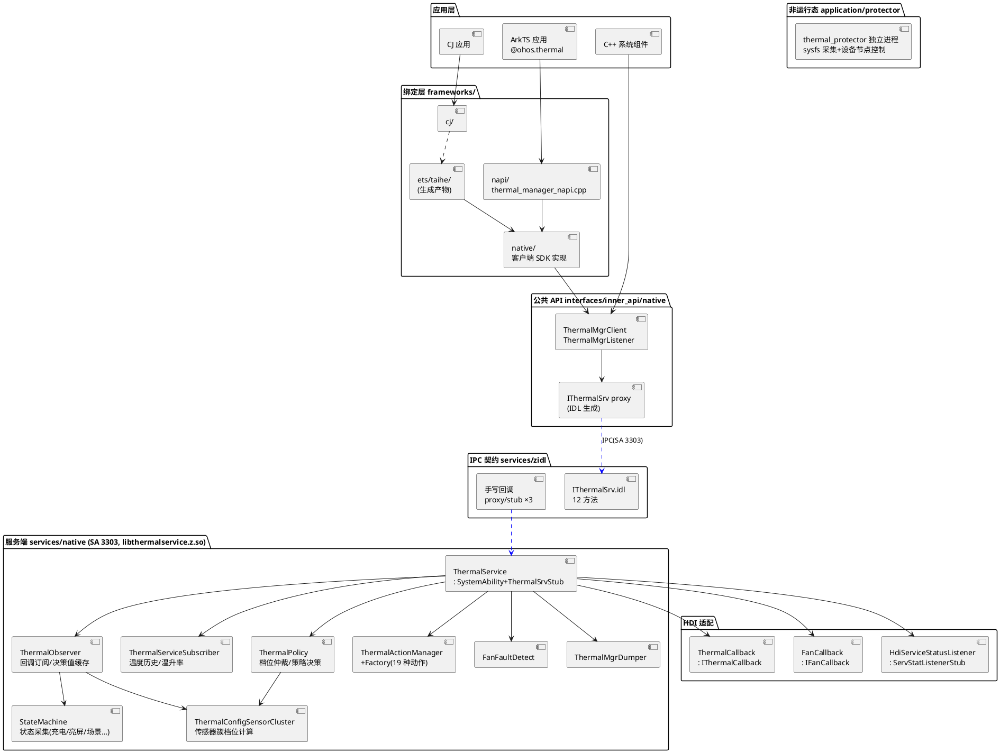
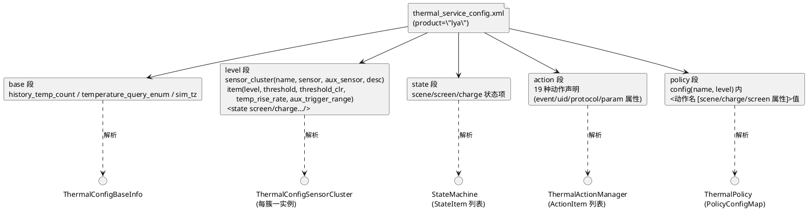

# thermal_manager 架构说明

> 本文描述静态结构：分层、目录、数据模型。运行动态机制见 [thermal-Technology.md](thermal-Technology.md)，业务背景见 [business-context.md](business-context.md)。

## 总体架构

### 分层结构

要点：

- **ThermalService 直接实现生成 stub**：`class ThermalService final : SystemAbility, ThermalSrvStub`（services/native/include/thermal_service.h:56），无独立服务适配类（与 power_manager 的 PowerMgrService+Adapter 双层不同）。
- **档位计算与策略解耦**：ThermalConfigSensorCluster 只算"本簇档位"，ThermalPolicy 负责多簇取严、状态机匹配与动作决策（thermal_policy.h:47-65）。
- **档位回调挂在动作管理器上**：SubscribeThermalLevelCallback 由 ActionThermalLevel（一个特殊动作对象）承载（thermal_action_manager.cpp:35-78）。
- **HDI 三件套**：温度回调（thermal_callback.h:26）、风扇回调（fan_callback.h:27）、HDI 服务状态监听重连（hdi_service_status_listener.h:27）。

### 目录结构

| 目录 | 职责 |
|---|---|
| interfaces/inner_api/native/ | 公共 C++ API：thermal_mgr_client.h、thermal_srv_sensor_info.h、thermal_level_info.h、三个回调接口 + 各自 *_ipc_interface_code.h、thermal_level_callback_stub.h、thermal_mgr_listener.h |
| frameworks/native | 客户端 SDK 实现（thermal_mgr_client.cpp 等 4 文件）；frameworks/napi 为 ArkTS 绑定，frameworks/cj、frameworks/ets/taihe 为另两套 |
| services/zidl | IPC 契约：IThermalSrv.idl（主接口由 idl_gen_interface 生成 proxy/stub，services/zidl/BUILD.gn:30-54）；回调方向 proxy/stub 手写在 include/、src/ |
| services/native/include/thermal_observer/ | 温度采集核心 thermal_observer.h + thermal_service_subscriber.h + thermal_sensor_info.h + state_machine/ 子目录（7 种状态采集器 + 工厂 + state_machine.h） |
| services/native/include/thermal_policy/ | 档位仲裁 thermal_policy.h、传感器簇 thermal_config_sensor_cluster.h、配置解析 thermal_srv_config_parser.h、基础信息 thermal_config_base_info.h、fan_fault_detect.h |
| services/native/include/thermal_action/ | 动作基类 ithermal_action.h、thermal_action_manager.h、thermal_action_factory.h、thermal_timer.h、action/ 子目录（11 个动作头文件 + action_soc/） |
| services/native/profile/ | thermal_service_config.xml（运行态温控配置：base/level/state/action/policy 五段） |
| application/protector | 独立进程源码：thermal_kernel_service、thermal_sensor_provider（epoll 轮询）、thermal_sensor_provision（sysfs 扫描）、thermal_kernel_policy、cpu/current/voltage 动作、thermal_kernel_config.xml |
| application/init | thermal_protector.rc + thermal_protector.cfg（init 拉起配置） |
| utils/native | 跨仓共享工具：constants.h、thermal_log.h、thermal_hisysevent.h、thermal_mgr_errors.h、thermal_xcollie.h、file_operation.h、string_operation.h |
| test/ | common/ + fuzztest/（16 个）+ resource/system_test + systemtest + unittest（含 mock/、mock_action/） |

构建元数据：bundle.json（syscap SystemCapability.PowerManager.ThermalManager，features 仅 thermal_manager_audio_framework_enable）；thermalmgr.gni（1 个 declare_args 开关 + 6 个 part 存在性检查：hiviewdfx_hisysevent、netmanager_base、audio_framework、display_manager、customization_config_policy、hiviewdfx_api_metrics）；thermalmgr.yaml（HiSysEvent 域 THERMAL，4 事件）。

## 关键数据结构

### 传感器与档位模型

- `SensorType`（interfaces/inner_api/native/include/thermal_srv_sensor_info.h:78-89）：枚举 SOC=0、BATTERY、SHELL、SENSOR1~SENSOR7，共 10 个，是面向客户端的类型抽象；服务端内部用字符串 type（如 "battery"、"pa"）流通。
- `ThermalSrvSensorInfo`（同文件 :22-73）：sequenceable，仅 type_、temp_ 两个成员，Marshalling/Unmarshalling 支撑跨进程传输。
- `ThermalLevel`（interfaces/inner_api/native/include/thermal_level_info.h:28-70）：枚举 COOL/NORMAL/WARM/HOT/OVERHEATED/WARNING/EMERGENCY/ESCAPE，共 8 值（0-7），对外即"温控档位"。
- `TypeTempMap = std::map<std::string, int32_t>`（thermal_observer.h:31）：服务端温度流通的基本形态，温度单位 0.001℃（配置中 40000 = 40℃）。

### 配置数据模型（thermal_service_config.xml → 内存）

| 结构 | 定义 | 说明 |
|---|---|---|
| LevelItem | thermal_config_sensor_cluster.h:34-39 | threshold（进档阈值）、thresholdClr（退档阈值）、tempRiseRate（温升速率门槛，默认 -1000000 表示不启用）、level |
| AuxLevelItem | 同上 :41-45 | lowerTemp/upperTemp 区间触发的辅助传感器条件 |
| TempDiffItem | 同上 :47-52 | sensor1 与 sensor2 温差条件 |
| PolicyAction | thermal_policy.h:28-33 | actionName、actionValue、actionPropMap（如 scene="cam"、charge="1"）、isProp |
| PolicyConfig | 同上 :35-38 | level + 该档位动作列表；PolicyConfigMap = map<簇名, vector<PolicyConfig>> |
| ActionItem | thermal_action_manager.h:29-36 | name、params、uid、protocol、strict、enableEvent |
| StateItem | state_machine.h:31-35 | name、params；驱动状态采集器实例化 |

### 温度历史与速率模型

`ThermalServiceSubscriber`（thermal_service_subscriber.h:28-56）为每个 type 维护 `std::deque<int32_t>` 历史队列（深度由配置 history_temp_count 控制，样例 10）与 `std::deque<double>` 速率队列（rateCount_ 默认 3），供 high_safe 簇 temp_rise_rate 判档使用。

## 架构图（配置视角）

加载顺序（thermal_service.cpp:210-349）：CreateConfigModule 创建五大组件 → InitConfigFile 解析 XML（config_policy 产品配置 → VENDOR → SYSTEM 兜底，:269-299）→ InitThermalObserver → InitActionManager → InitThermalPolicy → InitThermalSubscriber。protector 使用独立的 thermal_kernel_config.xml（schema 为 base+control 两段，application/protector/profile/）。
