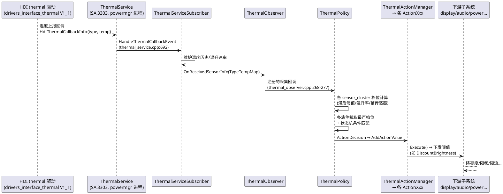

# thermal_manager 业务上下文

> 面向新成员：读本文即可理解 thermal_manager 为什么存在、为谁服务、解决什么问题。技术实现细节见 [architecture.md](architecture.md)，实体与机制详解见 [thermal-Entity.md](thermal-Entity.md) 与 [thermal-Technology.md](thermal-Technology.md)。

## 业务定位

thermal_manager 是 OpenHarmony 电源管理子系统（powermgr）的热管理服务，注册为系统服务 **SA 3303**，与 power_manager、battery_manager、display_manager 共享 `powermgr` 进程（sa_profile/3303.json:3-8）。系统系统能力为 `SystemCapability.PowerManager.ThermalManager`（bundle.json:11），对外提供三件核心价值：

1. **温度感知**：通过 HDI（drivers_interface_thermal V1_1）订阅内核热区（thermal zone）上报，维护 SoC、电池、外壳、充电 IC、环境温度等传感器最新值与历史值（见 [thermal-Technology.md](thermal-Technology.md) 机制一）。
2. **温控档位仲裁**：按产品配置（sensor_cluster 升降阈值、温升速率、辅助传感器、温差）计算各传感器簇档位，多簇取最严档位对外发布（thermal_service_config.xml；机制二、三）。
3. **温控动作下发**：按档位查策略表，把限频（cpu_big/gpu）、限流限压（current/voltage）、降亮度（lcd）、限音量（volume）、弹窗（popup）、断飞行模式（airplane）、杀进程（process_ctrl）、关机（shut_down）等动作下发到对应子系统（thermal_action_factory.cpp:50-86；机制四至六）。

服务进程常驻运行态；另设 **thermal_protector** 独立进程（`/system/bin/thermal_protector`，application/init/thermal_protector.rc:14-22），在系统启动早期（`on late-fs`）由 init 拉起，直读 sysfs 热区并直接控制充电电流/电压/CPU 频率节点，作为运行态服务未就绪或系统非完全运行时的兜底温控（详见 [thermal-Entity.md](thermal-Entity.md) 实体十六）。

消费方分四类：ArkTS 应用（frameworks/napi，@ohos.thermal 模块）、CJ 应用（frameworks/cj）、taihe FFI（frameworks/ets/taihe，生成产物）、C++ 系统组件（interfaces/inner_api 的 thermalsrv_client/thermalmgr_listener 两个 inner kit，bundle.json）。

## 核心业务流程

设备从"温度正常"到"执行温控"的完整闭环：

关键节奏：温度上报由 HDI 驱动主动推送（非本仓轮询）；档位计算依赖 threshold/threshold_clr 双阈值防抖；动作值在同一档位内多策略冲突时按"取严"仲裁（isStrict_，ithermal_action.h:105）。

## 典型使用场景

| 场景 | 触发链路 | 涉及模块 |
|---|---|---|
| 应用查询温控档位 | ArkTS `@ohos.thermal.getThermalLevel()` → NAPI → ThermalMgrClient::GetThermalLevel → IPC GetThermalLevel | frameworks/napi、thermal_mgr_client.h:41 |
| 应用订阅档位变化 | subscribeThermalLevelCallback(isSync) → 服务端 ActionThermalLevel 记录订阅并首报当前档位 | thermal_action_manager.cpp:57-63 |
| 高温自动降亮度 | base_safe 簇到 level N → policy 表 lcd 行 → ActionDisplay::DiscountBrightness(factor) | action_display.cpp:115-119 |
| 电池过温关机 | shut_down 动作值非 0 → ActionShutdown → PowerMgrClient | action_shutdown.cpp:21、:89 |
| 充电限流限压 | current_sc/voltage_sc/voltage_buck → ActionCharger/ActionVoltage | thermal_service_config.xml:74-77 |
| 相机场景差异化限频 | 业务 SetScene("cam") → 状态机 scene=cam → policy 命中 `<cpu_big scene="cam">` 行 | thermal_service.cpp:587-598 |
| 风扇故障告警 | FanCallback::OnFanDataEvent → FanFaultDetect::CheckFanTooSlow/TooFast → HiSysEvent FAN_FAULT | fan_fault_detect.h:40-48 |
| 开机早期充电保护 | init on late-fs 拉起 thermal_protector → sysfs 读 thermal_zoneN/temp → 内核配置档位 → 写电流/电压/CPU 节点 | application/protector/ |

## 演进方向

从代码结构可见的演进脉络（非承诺，仅现状推断）：

- **HDI 版本随动**：min_hdi_proxy_version 已声明 `libthermal_proxy_1.1.z.so` 与 `libbattery_proxy_2.0.z.so`（sa_profile/3303.json:12-15），HDI 接口升级由 drivers_interface_thermal 仓主导，本仓只消费。
- **多语言绑定齐全化**：NAPI（手写）+ CJ + taihe（生成）三套绑定并存，公共 API 变更需三处同步（AGENTS.md 知识路由）。
- **可测试性投入**：服务端内置温度模拟（dump EmulateTempReport、thermal_service.cpp:710）、动作 mock（EnableMock/CreateActionMockFile，thermal_action_manager.h:58-60）、16 个 fuzzer 与 30+ 单测文件（test/）。
- **产品配置差异化**：thermal_service_config.xml 携带 `product="lya"` 属性并通过 config_policy（GetOneCfgFile）实现产品级覆盖（thermal_service.cpp:269-299），说明产品形态差异主要落在配置而非代码。
