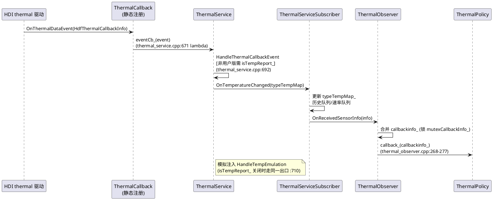
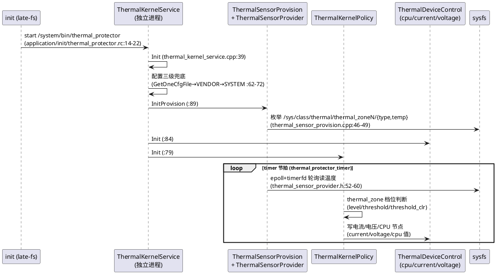

# thermal_manager 技术机制

> 每个机制按"问题 → 触发时机 → 执行流程 → 数据流 → 边界与陷阱"展开。实体静态职责见 [thermal-Entity.md](thermal-Entity.md)。

## 机制一：温度采集与上报链路

### 解决的问题
内核热区温度如何安全、低延迟地进入用户态温控决策，且与 HDI 版本解耦。

### 触发时机
HDI 驱动侧主动推送（本仓不轮询）：ThermalCallback::RegisterThermalEvent 注册的回调在驱动有新温度时触发（thermal_callback.h:30-31）。

### 执行流程

### 数据流
HdfThermalCallbackInfo.info（vector<{type, temp}>）→ TypeTempMap（map<string, int32_t>，单位 0.001℃）→ 订阅者按 typeList 过滤推送（NotifySensorTempChanged）。

### 边界与陷阱
- isTempReport_ 代码默认开（thermal_service.h:201）；非用户版编译时 HandleThermalCallbackEvent 受该开关门控，用户版（THERMAL_USER_VERSION）恒放行（thermal_service.cpp:692-696），hidumper SwitchTempReport 可现场切换。
- HandleThermalCallbackEvent 只做拷贝转发，重活下沉；回调内禁止阻塞（AGENTS.md 禁止事项）。
- 温度兜底链：config_policy → VENDOR → SYSTEM（InitConfigFile，thermal_service.cpp:269-299）。

## 机制二：档位计算与滞后防抖

### 解决的问题
温度在阈值附近抖动会导致档位/动作频繁切换（限频-恢复-限频振荡），需要带滞后、多条件融合的单簇判档算法。

### 触发时机
ThermalPolicy::OnSensorInfoReported 收到新温度快照后，逐簇调用 UpdateThermalLevel（thermal_config_sensor_cluster.h:62）。

### 执行流程
1. 按簇内每个传感器取当前温度（TypeTempMap 查表）。
2. 升档走 AscendLevelToThreshold/LevelUpwardsSearch，降档走 DescendLevelToThresholdClr/LevelDownwardsSearch（:80-95）——threshold 与 thresholdClr 之间的区间保持原档位（滞后带）。
3. 附加条件按开关启用：IsTempRateTrigger（温升速率 + GetRateTrend 趋势 IDEAL/STABLE/CRITICAL）、IsAuxSensorTrigger（辅助传感器区间）、IsTempDiffTrigger（双传感器温差）、CheckExtraCondition（:100-105）。
4. descFlag_ 簇（冷保护，如 cold_safe）用降序阈值表。

### 数据流
LevelItem{threshold, thresholdClr, tempRiseRate, level} × N 档 + TypeTempMap → latestLevel_。样例：high_safe 簇 threshold=40000/thresholdClr=38000/temp_rise_rate=1.5（thermal_service_config.xml）。

### 边界与陷阱
- tempRiseRate 缺省 -1000000 表示不启用（thermal_config_sensor_cluster.h:37）。
- 速率窗口 rateCount_=3、历史深度 history_temp_count（样例 10）都在 base 段配置。
- 多传感器簇的 threshold 是逗号列表，按位对应 sensor 列表，数目不匹配配置非法（CheckStandard :61）。

## 机制三：多簇档位仲裁

### 解决的问题
多个传感器簇同时给出不同档位（电池热 vs AP 热 vs 冷保护）时，对外只能有一个 ThermalLevel。

### 触发时机
各簇 UpdateThermalLevel 完成后，ThermalPolicy::LevelDecision 汇总（thermal_policy.h:61）。

### 执行流程
1. 遍历 sensorClusterMap_，收集 clusterLevelMap_（簇名→档位）。
2. SortLevel 按档位排序，取最严（最大）档位作为本周期 ThermalLevel（thermal_policy.h:58）。
3. WriteLevel :60 落地：更新 ActionThermalLevel 的值 → 触发档位回调推送 → 打 LEVEL_CHANGED 事件。

### 数据流
clusterLevelMap_ → 全局 ThermalLevel（uint32_t，0-7 映射 ThermalLevel 枚举）→ 订阅者/公共事件。

### 边界与陷阱
- "取最严"对冷保护同样成立：cold_safe 升档会抬高全局档位。
- dump 可观测：ThermalPolicy::DumpLevel 输出簇级档位（thermal_policy.h:54）。
- 档位语义对外 8 值（thermal_level_info.h:28-70），配置档位数（level N）由产品自定，N 超出枚举域属配置错误。

## 机制四：策略决策与状态机匹配

### 解决的问题
同一档位下不同场景（相机 vs 通话 vs 充电中）应执行不同强度的动作；策略行需要按状态属性精确命中。

### 触发时机
档位确定后 PolicyDecision（thermal_policy.h:62）查 PolicyConfigMap[簇名] 中 level 匹配的 PolicyConfig。

### 执行流程
1. ActionDecision(:63) 取出该档位的 policyActionList。
2. 逐条 PolicyAction：若 isProp，actionPropMap 中每个键（scene/charge/screen…）到 StateMachine 状态表查值，全等才命中（StateMachineDecision :64）。
3. 命中项经 FindSubscribeActionValue 同步动作订阅者，并 AddActionValue 到对应动作对象。
4. ActionExecution(:65) 统一触发动作 Execute。
5. 场景值来源：SetScene 写静态 scene_（鉴权 + sceneMutex_，thermal_service.cpp:587-598）；其余状态由 UpdateThermalState(:600) 或各采集器公共事件落地（StateMachine::UpdateState，state_machine.h:41）。

### 数据流
XML policy 段样例：`<config name="base_safe" level="1">` 内 `<lcd scene="cam">0.99</lcd>`、`<cpu_big scene="cam" charge="1">1991800</cpu_big>`、`<gpu screen="0">524288</gpu>`（thermal_service_config.xml）→ 解析为 PolicyConfigMap。

### 边界与陷阱
- 带 prop 的行与不带 prop 的行可共存，策略引擎按"更具体的优先"——实现上是逐行过滤，同动作多行命中时靠动作侧取严仲裁（见机制五）。
- 场景是全局单值，业务异常退出未清理会把温控持续压在该场景（AGENTS.md 陷阱清单）。
- isImmed=true 时状态更新立即触发重决策（UpdateThermalState 第三参）。

## 机制五：动作执行与限值仲裁

### 解决的问题
同一动作一周期内可能收到多条策略值（多簇同档位、多条 prop 行），需要确定性仲裁；部分动作要求"延迟生效"以避免瞬态过控。

### 触发时机
ThermalPolicy::ActionExecution 逐动作调用 IThermalAction::Execute（ithermal_action.h:63-101）。

### 执行流程
1. AddActionValue 累积值；Execute 先清理"上轮存在、本轮消失"的策略延迟定时器（:66-77）。
2. 带 delayTime 的策略项建 WAKEUP|EXACT 定时器（TimeServiceClient 取墙钟，:78-98），到期回调置 isCompleted 并补 ExecuteInner（:86-92）。
3. 无延迟路径直接 ExecuteInner()（:100）；子类在 ExecuteInner 里做值仲裁与下发。
4. 新周期开始前各动作 ResetActionValue（SOC_PERF SA 就绪时对 SocActionBase::SocSet 统一重置，thermal_service.cpp OnAddSystemAbility）。

### 数据流
多条 string actionValue → 单一下发值。整型类（cpu_big/gpu/current/voltage）取最严（最小频率/电流/电压）；比例类（lcd/volume）取最小比例；isStrict_（ActionItem.strict，缺省 true）决定是否严格模式。

### 边界与陷阱
- enableEvent_（ActionItem event 属性）控制是否打 ACTION_TRIGGERED 事件（含 VALUE 与 RATIO 两个字段，thermalmgr.yaml）。
- ActionItem.uid（如 volume 的 "2001,2002"）限定动作只作用于指定 uid 集合。
- 定时器泄漏防护：Execute 每轮清理消失策略的 timer（:66-77），但进程退出不保证回收，重启依赖系统定时器服务。

## 机制六：三类回调分发与死亡通知

### 解决的问题
订阅者（系统组件/应用侧代理）异常退出后，服务端不能向死代理推送（IPC 异常刷日志、泄漏订阅项）。

### 触发时机
订阅/退订（Subscribe/UnSubscribe 系列，thermal_observer.h:43-48）与每次数据更新（NotifySensorTempChanged :50 / DecisionActionValue :51-52 / ActionThermalLevel::NotifyLevelChanged）。

### 执行流程
1. 订阅：回调入 set（按 AsObject() 排序去重，:86-98），同时注册 SensorTempCallbackDeathRecipient/ActionCallbackDeathRecipient（:67-79）。
2. 推送：温度按订阅 typeList 过滤成 TempCallbackMap 推送；动作按 actionList 过滤成 ActionCallbackMap；档位推送前先经 FindSubscribeActionValue 汇总最新决策值。
3. 死亡：OnRemoteDied 摘除订阅项与类型表项。
4. 档位订阅 isSync=true 时立即首报当前档位（SubscribeThermalLevelCallback 第二参，IThermalSrv.idl:24）。

### 数据流
服务端 set<sptr<IThermalTempCallback>> + map<callback, typeList>；客户端 ThermalMgrListener::ThermalLevelCallback 继承手写 ThermalLevelCallbackStub 接收（thermal_mgr_listener.h:37-41）。

### 边界与陷阱
- 客户端侧 ThermalMgrClient 也挂 ThermalMgrDeathRecipient 监视服务死亡（thermal_mgr_client.h:50）。
- 回调内再调客户端 API 有死锁风险（同步 IPC 重入），订阅者应异步化处理。
- 推送是逐个同步 IPC，订阅量大时注意 fan-out 延迟（当前锁粒度：temp/action 各一把，thermal_observer.h:102-105）。

## 机制七：IPC 双轨（IDL 生成 + 手写回调）

### 解决的问题
主接口随 .idl 演进可自动生成 proxy/stub；回调方向（服务端主动推送）的序列化与线程模型需要手工控制，二者共存且边界清晰。

### 触发时机
构建期（idl_gen_interface，services/zidl/BUILD.gn:30-54）与任何 IPC 变更评审时。

### 执行流程
1. 主接口：IThermalSrv.idl 12 方法 → 生成 thermal_srv_proxy/stub（proxy 源集 filter "*_proxy.cpp"）。
2. 服务端落地：ThermalService 直接继承生成 stub（thermal_service.h:56）。
3. 回调方向：IThermalTempCallback/IThermalLevelCallback/IThermalActionCallback 三接口在 idl 声明（:16-18）但 proxy/stub 手写在 services/zidl/include|src（thermal_temp_callback_proxy.h 等）；客户端继承 stub（thermal_level_callback_stub.h 在 interfaces/inner_api/native/include）。
4. 码值：主接口 [ipccode N] 从 0 递增（idl:22 起）；回调方向码值在 *_ipc_interface_code.h。

### 数据流
跨进程两类消息：请求（client→server，生成 stub 分发）与推送（server→client，手写 proxy 发送、手写 stub 分发）。

### 边界与陷阱
- 判别"能否手改"的标准是文件位置语义：生成物（BUILD.gn target_gen_dir）不可手改；services/zidl 下的 callback proxy/stub 是手写源码，可维护但要同步 idl 声明。
- 新增主接口方法必须追加新 ipccode，禁止复用（ABI 兼容）。

## 机制八：HDI 状态监听与自动重连

### 解决的问题
thermal HDI 服务（驱动侧）异常重启后，已注册的温度/风扇回调失效，需要自动感知并重订阅，否则温控永久失聪。

### 触发时机
HDI ServiceManager 上报服务状态变化（上线/下线）到 HdiServiceStatusListener::OnReceive（hdi_service_status_listener.h:27-31）。

### 执行流程
1. ThermalService::RegisterHdiStatusListener（thermal_service.cpp:617）把重订阅逻辑挂到 StatusCallback。
2. HDI 下线→上线后：重新 GetThermalInterface、ThermalCallback::RegisterThermalEvent（:671 lambda 链）、风扇侧 RegisterFanHdiCallback（:720，先判 fanFaultDetect_->HasFanConfig）。
3. 失败路径循环重试（:623、:655 两处 return RegisterHdiStatusListener() 递归重试）。

### 数据流
HDI 服务状态事件 → StatusCallback(std::function) → 服务端重订阅动作；无持久状态。

### 边界与陷阱
- min_hdi_proxy_version 声明 libthermal_proxy_1.1 + libbattery_proxy_2.0（sa_profile/3303.json），降版本即破坏此处假设。
- SA 依赖声明里 battery HDI 供充电电流/电压动作使用；重连只覆盖 thermal 通道的回调，充电通道由其自身代理维护。

## 机制九：风扇故障检测

### 解决的问题
带风扇设备（样例产品 lya）需要识别风扇堵转/超速并在故障发生时留下 FAULT 级事件证据。

### 触发时机
FanCallback::OnFanDataEvent 收到风扇上报（fan_callback.h:31）→ FanFaultDetect::OnFanSensorInfoChanged（fan_fault_detect.h:40）。

### 执行流程
1. 无风扇配置直接返回（HasFanConfig :42，配置空则服务端根本不订阅风扇 HDI）。
2. CheckFanSensorInfo 校验上报完整性。
3. CheckFanTooSlow/CheckFanTooFast 对照 FanFaultInfoMap 门限（转速 + 相关硬件温度）。
4. 命中即发 HiSysEvent FAN_FAULT（ID/MSG，thermalmgr.yaml，FAULT 级）。

### 数据流
HDF 风扇数据 → FanSensorInfo ↔ 配置门限（map<int32_t 故障号, FanSensorInfo>，fan_fault_detect.h:33）→ FAN_FAULT 事件。

### 边界与陷阱
- FanSensorInfo 的字段是 ABI（与 HDI thermal_types.h 对齐），改门限结构要同时核对 HDI 版本。
- 无风扇产品必须保证配置无 fan 段，否则 HasFanConfig 误判会引发无效 HDI 订阅。

## 机制十：温度模拟与测试注入

### 解决的问题
真机高温难构造；单测/系统测试需要可控的温度源与可控的动作端。

### 触发时机
开发调试（hidumper 命令）与测试用例（test/unittest/src/thermal_*_test.cpp、mock_action/）。

### 执行流程
1. 服务端初始化即面向测试：InitConfigModule 走 SYSTEM 配置（thermal_service.cpp:302-317）、动作侧 CreateActionMockFile/EnableMock（thermal_action_manager.h:58-60）、订阅侧支持 mock proxy/stub（test/unittest/src/thermal_mock_*_test.cpp 系列）。
2. 温度注入：hidumper -s 3303 → ThermalMgrDumper::EmulateTempReport（thermal_mgr_dumper.h:36）→ HandleTempEmulation（thermal_service.cpp:710）→ 与真实上报同一出口 OnTemperatureChanged。
3. 开关：SwitchTempReport（:34）切换 isTempReport_（默认 true，thermal_service.h:201），控制真实/模拟通道择一。

### 数据流
dump 参数 → TypeTempMap → subscriber（SetHistoryTypeTempMap 亦可直接注历史，thermal_service_subscriber.h:34）→ 正常决策链。

### 边界与陷阱
- 模拟与真实互斥：isTempReport_ 开着时 HandleTempEmulation 返回 false（:711-714）。
- 用户版本编译（THERMAL_USER_VERSION）真实上报不受开关限制（:692-696 的条件编译）。
- fuzz 入口已覆盖该面：thermal_fuzzer、thermalservice_fuzzer 等 16 个（test/fuzztest/）。

## 机制十一：DFX 可观测性

### 解决的问题
温控是"慢故障"高发区（档位不动、动作未生效），必须全链路留痕：结构化事件 + 看门狗 + dump 三通道。

### 触发时机
档位变化（WriteLevel）、动作触发（各 ActionXxx ExecuteInner，enableEvent_ 门控）、风扇故障（机制九）、每周期调试日志。

### 执行流程
1. 事件：thermal_hisysevent.h 封装 thermalmgr.yaml 四事件——POWER_TEMPERATURE（NAME/TEMPERATURE）、LEVEL_CHANGED（LEVEL）、ACTION_TRIGGERED（ACTION/VALUE/RATIO）、FAN_FAULT（ID/MSG），域 THERMAL，前三个 STATISTIC、末个 FAULT。
2. 看门狗：IPC 入口 ThermalXCollie 护栏（thermal_xcollie.h；用例 thermal_service.cpp:588-589、:601-602）。
3. 日志：THERMAL_HILOG* 宏 + COMP_SVC 等模块标签（thermal_log.h）。
4. dump：hidumper -s 3303 聚合各组件 Dump*（机制十入口同一类）。

### 数据流
决策/动作现场 → HiSysEvent（hiviewdfx 消费）+ hilog + dump 文本三路输出。

### 边界与陷阱
- yaml 是事件 schema 单一事实源，新增事件先改 yaml 再打点（AGENTS.md 约束）。
- 删除事件/日志属禁止事项（与 battery_manager 仓相同的黄线）。

## 机制十二：多语言绑定与版本管控

### 解决的问题
同一公共 API 要同时服务 ArkTS、CJ、C++ 三类消费者，且符号可见性可演进。

### 触发时机
任何 interfaces/inner_api 变更评审。

### 执行流程
1. C++ 基座：thermal_mgr_client.h 等（interfaces/inner_api/native/include）。
2. ArkTS：frameworks/napi/thermal_manager_napi.cpp——新旧两组导出（subscribeThermalLevel/registerThermalLevelCallback 等 6 函数，:129-139）+ ThermalLevel 常量对象（cool/normal/warm/hot/overheated/warning/emergency/escape，:140 起）+ 模块注册 nm_modname "thermal"（:297-301）。
3. CJ：frameworks/cj/；taihe：frameworks/ets/taihe/（生成产物，源在 .taihe，路径见 thermalmgr.gni taihe_generated_file_path）。
4. 符号版本：*.map 版本脚本管控导出集合。

### 数据流
公共 API 签名 → 三套绑定 → 应用侧调用。

### 边界与陷阱
- 三套绑定必须同步变更（AGENTS.md 计划阶段声明项）；taihe 与 zidl 生成物均不可手改。
- NAPI 新旧接口并存是刻意的兼容策略，删旧接口属破坏性变更。

## 机制十三：非运行态温控（protector）

### 解决的问题
powermgr 进程（SA 3303 所在）在开机早期尚未拉起、或运行态服务异常时，充电高温仍需保护——需要一个零依赖的独立温控执行体。

### 触发时机
init 在 on late-fs 阶段拉起 thermal_protector（application/init/thermal_protector.rc:14-22），进程常驻。

### 执行流程

### 数据流
thermal_kernel_config.xml（base + control 段，thermal_zone type="soc-thermal" interval="2000"）→ 内存模型（protector_thermal_zone_info）→ 档位 → 设备节点写入值。

### 边界与陷阱
- **零依赖铁律**：不得引入对 samgr/HDI/ThermalService 的依赖（AGENTS.md 禁止事项）；因此配置 schema 与运行态完全不同（control 段内联动作值，无独立 policy 段）。
- 身份差异：rc 以 root + u:r:thermal_protector:s0 运行，cfg（Services 模块形态）以 uid thermal + u:r:thermal:s0 运行——两份拉起配置并存于 application/init/，部署目标不同，改其一需评估另一个。
- 与运行态并发控制同一批节点属产品配置问题，需在产品配置层面保证职责分界（运行态就绪后由产品决定是否停用 protector 动作）。
